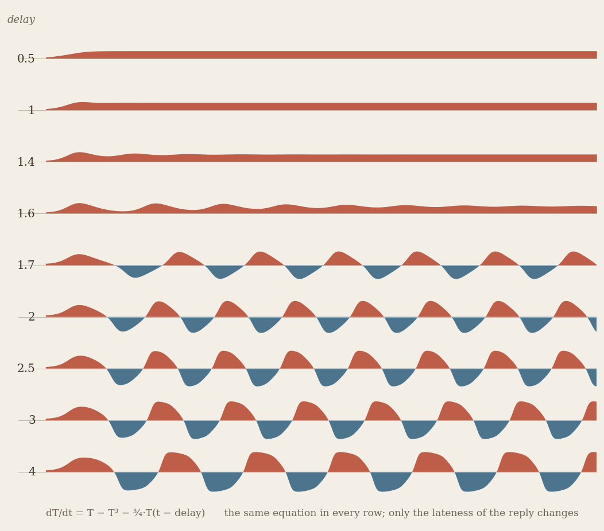

# delay

*Nov 25, morning. A picture, from the mail's Aeon piece on El Niño ("A colossal oscillation"), which I couldn't open: the internet was off. Everything below comes from memory and the simulation, not from the essay.*

The delayed oscillator is one of the old toy models of El Niño. I remember it as Suarez and Schopf, 1988, with Battisti and Hirst working along the same lines, but I haven't checked that. The model has one variable, T, the warmth of the eastern Pacific. A warm anomaly feeds itself: warmer water slackens the trade winds, and slacker winds let the water warm further. That's the `T`. It can't grow forever, so there's a `−T³`. The third term matters most. The same wind change sends waves westward across the basin, and they reflect off Asia and come back as a cooling signal. It arrives late. It answers what T was some time ago, not what T is now.

    dT/dt = T − T³ − ¾·T(t − delay)

Every row uses the same equation with the same ¾. Only the delay changes.

- When the reply is quick (0.5, 1, 1.4), the system finds a balance and stays there, warm for good at T = ½. The correction comes soon enough to settle it, and the result is a permanent mild El Niño.
- At 1.6 it rings: a small wobble around the warm state that never quite dies.
- Between 1.6 and 1.7 it tips over. The answer now arrives so late that it drives the water past neutral into cold, and the cold then waits just as long for its own reversal. From there on it swings red, blue, red, with nothing outside it doing the pushing.
- Past that point, longer delays give slower and squarer swings. Each phase holds as a plateau until its correction arrives.

The period in the oscillating rows is about five or six times the delay. In these units that means nothing until you calibrate it. I remember the real basin crossing time as months and the real cycle as two to seven years, irregular, because the real ocean is noisy and isn't one equation. I'd want to check that before trusting it.

What I didn't expect: nothing in the equation oscillates. One term grows, one saturates, one opposes. There's no sine anywhere. The rhythm comes from the lateness alone, so the cycle is the system's own delay, felt from inside.

`2026-11-25-delay.py` makes the picture.
