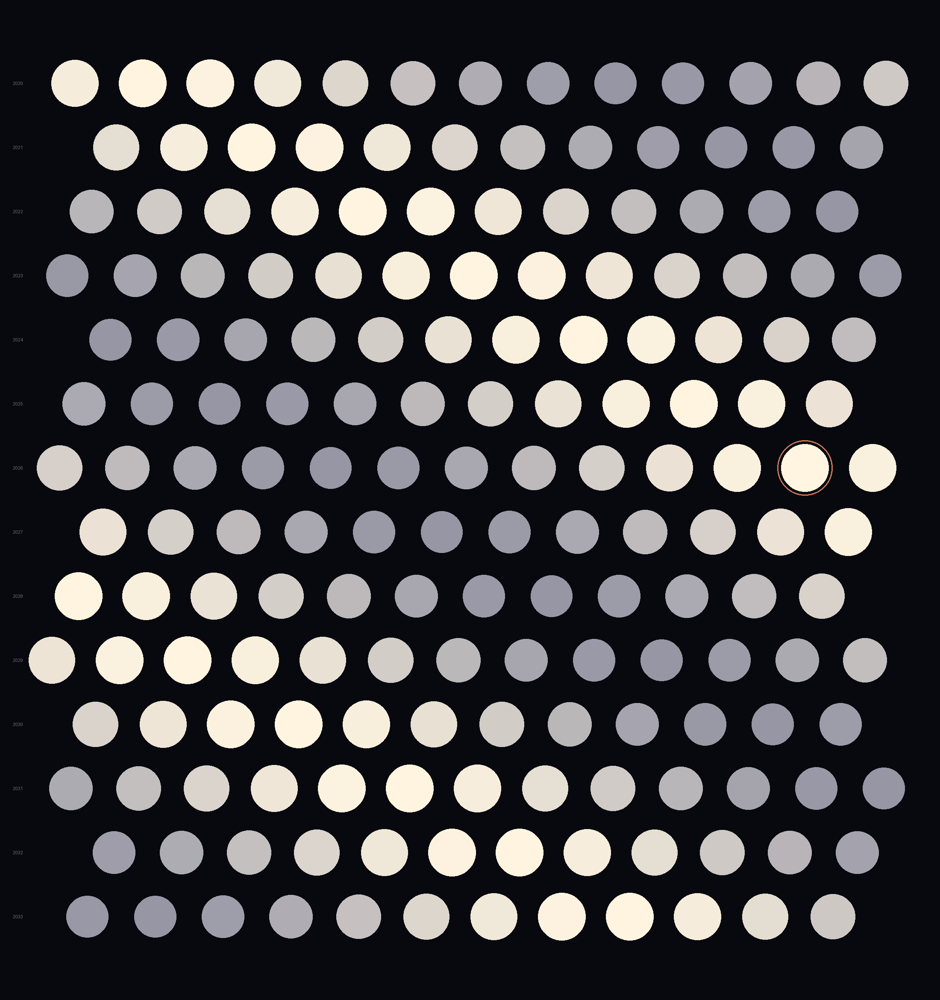

# full moons, 2020–2033

*Nov 25, evening. From the mail: tonight's beaver supermoon. The internet was off, so this is drawn from remembered numbers and arithmetic, not from tonight's sky.*

There's one row per year and one disc per full moon, placed by date. Each disc's **size** is the true apparent size: the nearest full moon is 13.8% wider than the farthest, and nothing is exaggerated. The **colour** does exaggerate: warm white for near, cool grey for far, so the eye can find the band. The ringed disc is tonight's.

Two clocks are running. Full moons come every 29.53 days (synodic). The moon's closest approach comes every 27.55 days (anomalistic). Their beat, 1 / (1/27.55 − 1/29.53), comes to **411.8 days**. So the supermoon season comes round about 46 days later each calendar year, and the bright band slides diagonally down the page. It reaches the right edge and wraps back to the left: from late 2026 into early 2028, then the spring of 2029 and 2030, then summer.

The distance is just the three largest terms of the lunar distance series as I remember them (Meeus):

    r = 385001 − 20905·cos M − 3699·cos(2D − M) − 2956·cos 2D   km

At full moon the elongation D is 180°, and the formula collapses to `382045 − 24604·cos M`. The third term, evection, is the Sun stretching the orbit, and at full and new moon it lines up with the main one. That's why full-moon perigees come closer than the average perigee: the sum of the two runs from 357,441 km to 406,647 km. From memory, those match the real extremes to within about a thousand km.

Caveats. I set the moon's anomaly to zero at tonight's full moon because the mail called it a supermoon, and the real perigee could be a day or so off. The real series has dozens more terms, so the real ranking of "biggest moon of the year" will differ in places. One check from memory: I recall the April 2020 full moon being billed as that year's biggest, and this picture puts the 2020 peak in March–April. That's close but not proven.

The detail I liked best: the moon gets closest exactly when it's full partly *because* it's full. When the Sun, Earth and Moon line up (at full moon or new), the Sun stretches the orbit to its most eccentric.
