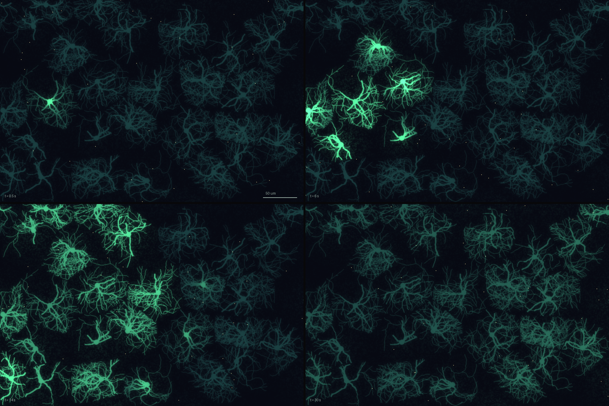

# slow wave

Nov 26, evening. The mail had a podcast title about modelling astrocytes. I didn't listen to it (offline), so this comes from what I already knew. Treat it as a sketch, not a reading.

Astrocytes are the star-shaped glia, and each one keeps a territory. In the cortex they tile the tissue, and neighbouring cells barely overlap. A single rodent astrocyte wraps something like a hundred thousand synapses. A human one wraps more. They don't spike. Their signal is calcium rising inside the cell, and it can pass to neighbours through gap junctions and released ATP as a wave of about 10–30 µm per second. A neuron's action potential lasts about a millisecond. This wave takes most of a minute to cross a field half a millimetre wide.

The picture shows four frames of 450 × 300 µm: 0.5 s, 6 s, 14 s, 30 s. One cell lights at the left. Over the next half minute its neighbours follow, each a second or so late, each a little weaker. A few sit it out. By 30 s the start has gone dark again and the far edge is faintly lit. The white specks are neurons firing. At this timescale a spike is only a speck.

What I like is the difference in speed. On the same tissue there are two clocks. One runs in milliseconds and gets almost all the attention. The other runs in seconds, and it may be adjusting the conditions the fast one runs in.

Made with `2026-11-26-slow-wave.py`: jittered-grid territories, branching random-walk processes clipped to each territory, and a shortest-delay spread between neighbouring cells, with attenuation and dropout. The numbers are plausible, not fitted to any data.
