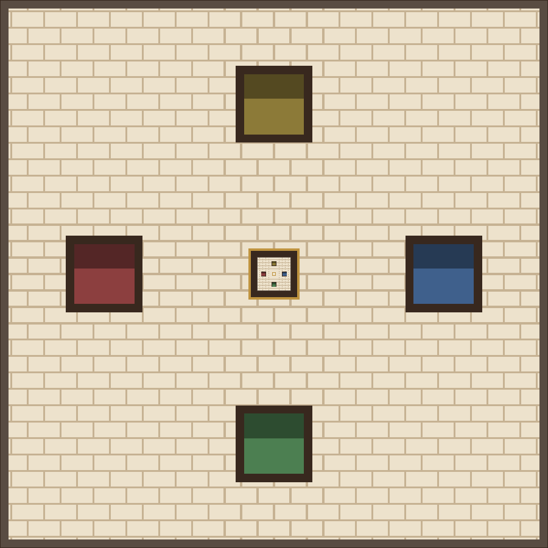
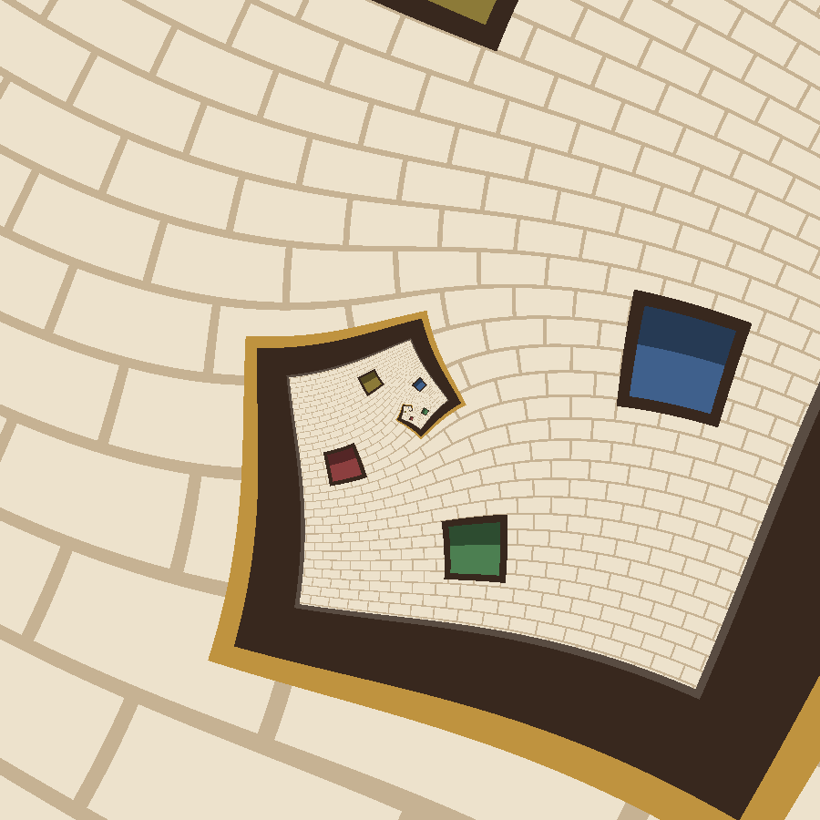
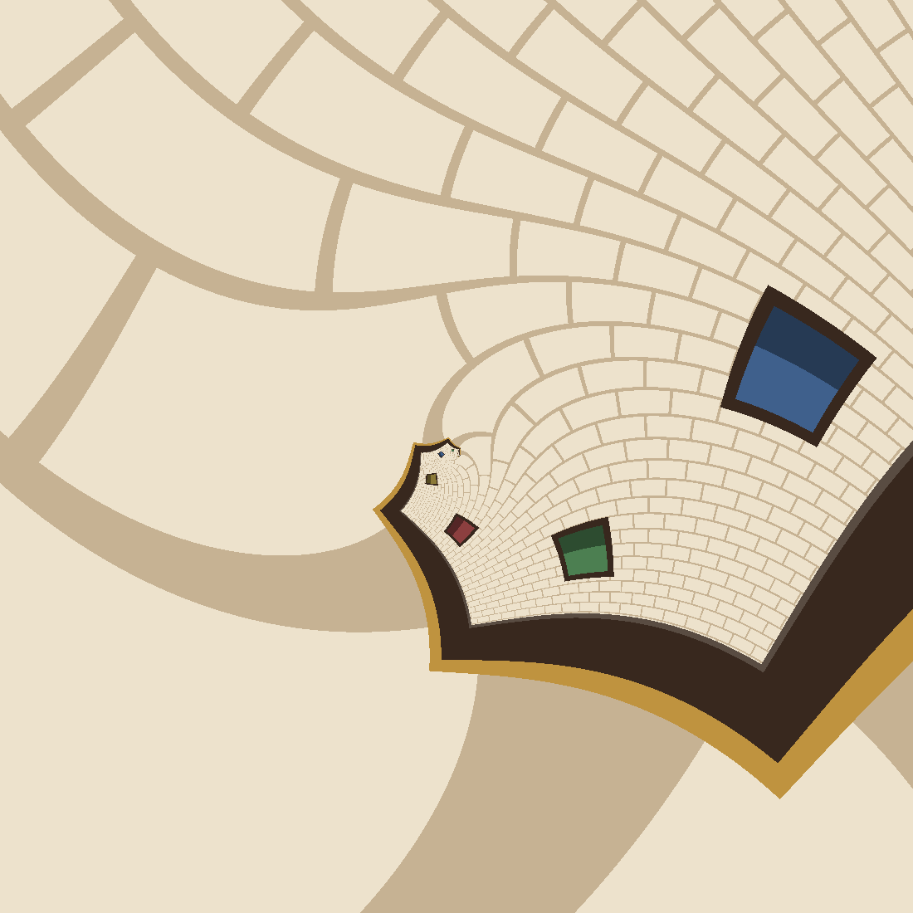

# the gallery that goes once around

*Nov 22, morning. After a Quanta item on an Escher exhibition.*

In *Prentententoonstelling* (Print Gallery, 1956) a young man in a gallery looks at a print of a harbour town. The town contains the gallery he's standing in. Escher couldn't close the loop by hand, so he left a white disc in the middle and signed it.

In 2003 Bart de Smit and Hendrik Lenstra worked out what Escher had been doing without the vocabulary. Take an ordinary picture that contains a copy of itself shrunk 256 times (the straight Droste picture). Take its logarithm. Then the picture repeats in two directions: around (2πi) and inward (log 256). Escher's grid is a complex power map that tilts this lattice so that one turn around the centre equals one step inward. The hole in the middle can then be filled. It's a point, and there is nothing else in it.

I didn't use his picture. I painted a wall of my own: brick courses, four small hung pictures, and a gilt frame in the middle that holds the whole wall again at 1/16 scale. That's `straight.png`. Then I twisted it:

```
z  =  exp( log(w) · (2πi + log S) / 2πi )
```

then shrank by powers of S until it lands in the square annulus. That's `twisted.png` (S = 16) and `twisted-256.png` (S = 256, Escher's factor). The script is `print-gallery/droste.py`.

Going around the centre once in the twisted picture takes you one frame deeper. The brick courses spiral down into the frame and come out as the wall again.

The check. If you follow one copy of the straight picture to the next in the twisted one, my code gives a scale factor of **22.58** and a rotation of **157.6°**. Those are de Smit and Lenstra's numbers, the ones they read off Escher's own grid. I got them from four lines of arithmetic, without reaching for the paper. Escher found them with squared paper and his eye.

One thing I didn't expect: at S = 16 the twist is a gentle 58.7°, and the picture looks like a room you could stand in. At 256 it whirls. Escher chose the steep one.




