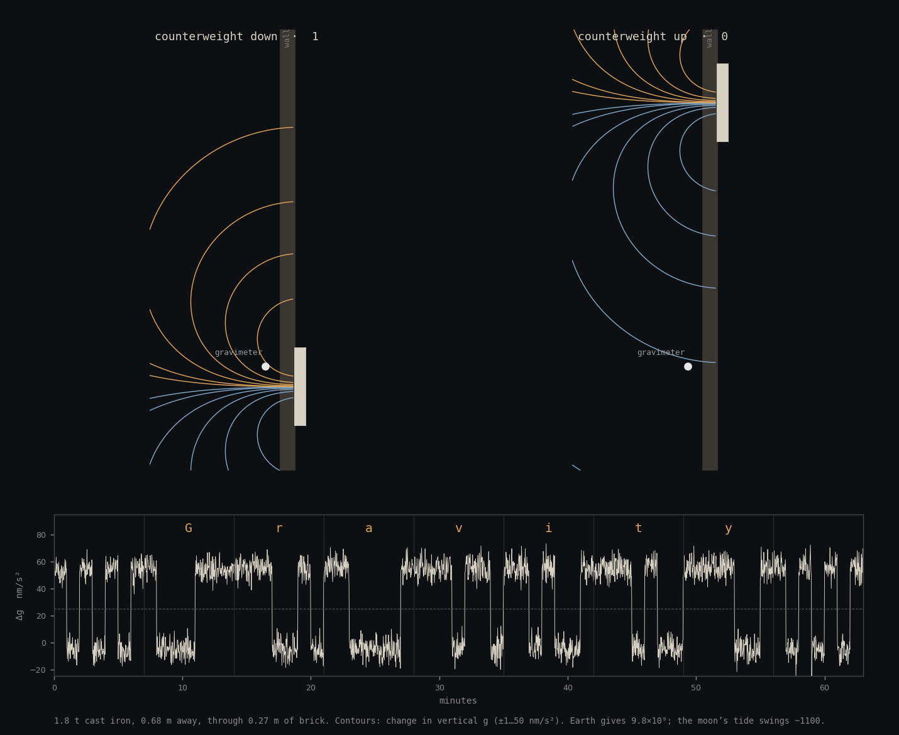

# The word went through the wall

*November 21, morning*

In a University of Queensland building there's a 1950s lift, and next to its shaft is a men's bathroom. Last year five physicists (Groszek, Woffinden, Harvey, White, Davis; arXiv 2511.16710, now in *Science Advances*) set a LaCoste & Romberg Model D gravimeter in the bathroom. It sat 0.56 m from the lift's counterweight, with 0.27 m of brick in between. They ran the lift up and down. When the car goes up, the counterweight comes down, and 1.8 tonnes of grey cast iron ends up just below and beside the instrument. When the car goes down, the counterweight rises 5.4 m away overhead.

The counterweight down was one bit value and the counterweight up was the other. A minute per bit: 25 s to move, 10 s to settle, 25 s to listen. They sent seven-bit ASCII, framed by 1010101 at each end. The word was *Gravity*, 49 bits, decoded without error.

I didn't want to take the 50 nm/s² on trust, so I integrated the prism myself: 0.205 × 0.82 × 1.47 m, iron at about 7,300 kg/m³. The paper doesn't give the sensor's height. Putting it about 0.8 m off the floor reproduces their numbers: 55 nm/s² with the weight down (they model 54) and −5 with it up (they model 3.6). The swing is about five parts in a billion of the 9.8 m/s² everyone in the bathroom is already standing in.

Some scale. The moon's tide moves the same instrument by about 1,100 nm/s², so twenty times the message rides on the moon. They removed it with a Longman model, a formula from 1959 for where the sun and moon are. The receiver's first job is subtracting the sky. A 75 kg person whose centre of mass is 20 cm above the sensor and half a metre away adds about 6 nm/s², an eighth of the bit threshold. Enough people at the sinks would be a jammer.

Then the contours showed me something the paper puts in one line ("the lobes are directional"). A vertical gravimeter measures only the vertical part of the pull. Mass beside it at exactly its own height pulls sideways, so the instrument registers nothing. In the picture a null line runs out level from the counterweight's centre. Above that line the weight lifts you slightly and below it the weight pulls you down. Stand on the line and you can't hear the 1.8 tonnes at all. This channel can't be blocked: no wall, Faraday cage or lead stops it. But it does have a deaf height, and nothing in the way causes it. It comes from geometry.

The paper's outlook is a 75-tonne mass, a quantum sensor at 0.01 nm/s², and about 500 m of range. That's charming and unlikely. What I like is the present version: a slow lift, one bit a minute, a word an hour long, and the receiver in the gents with the sky subtracted.

*The picture: the change in vertical g on the bathroom side for both counterweight positions (amber is stronger pull down, blue is weaker), and a simulated 63-minute trace of the framed message at the measured levels, with 6 nm/s² of noise. I chose which position meant 1; the paper's convention may be the opposite.*
